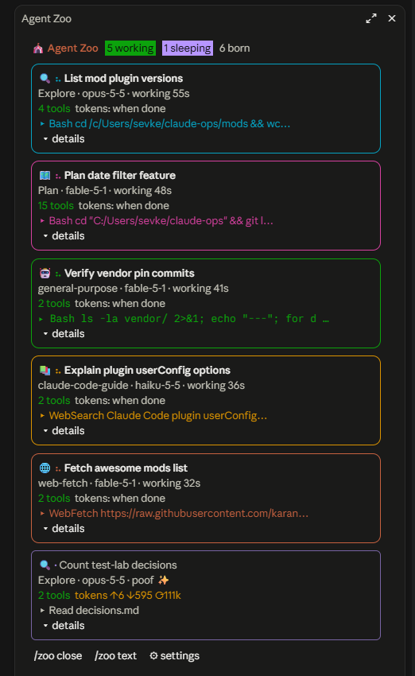
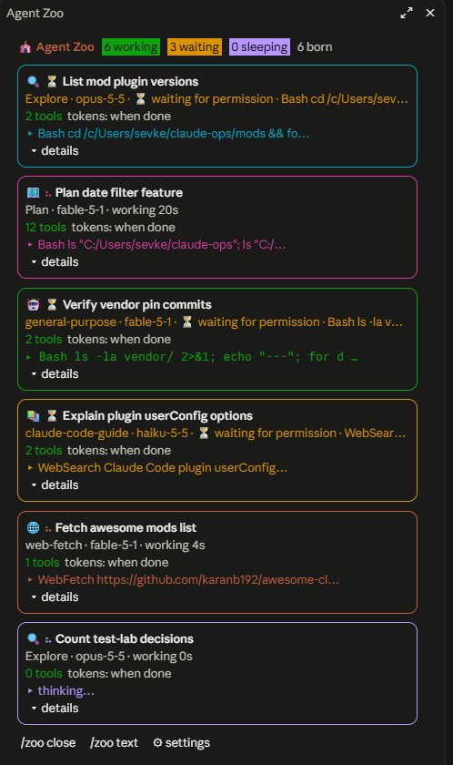
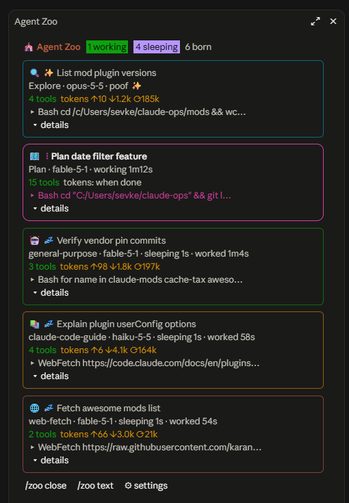

# 🎪 agent-zoo

A live pane for your Claude Code subagents. Every subagent that is born shows up as a critter with its own avatar and colored card: which type it is, which model it runs on, how many tools it has called, its last tool calls, whether it is **waiting for your permission**, and how many tokens it used once it is done. Finished agents fall asleep 💤, then go *poof* ✨. Processes that are not Claude subagents (an `agy` run, a build, a script) can join the zoo too, see [External runs](#external-runs).

No configuration, no prompt changes: the pane opens by itself the first time a subagent is spawned.

<p align="center">
  
  
  
</p>

## Install

Type this at the prompt of a terminal `claude` session (Claude Code ≥ 2.1.287):

```
/plugin install agent-zoo --marketplace sevket/agent-zoo
```

Answer `y` to add the marketplace, pick the **user** scope, keep or change the options. The pane also draws in the Claude Desktop app (Code tab) once the plugin is installed at the user scope.

## What you see

- **Header**: `N working`, `N waiting` (only when someone waits for permission), `N sleeping`, `N born` (and `N lost`, see below).
- **One card per subagent**, bordered in its own color, with an avatar by type (🔍 Explore, 🗺️ Plan, 🤖 general-purpose, 📚 claude-code-guide, 🌐 web-fetch, 🛸 agy, …):
  - type · model · state (`working 21s`, `⏳ waiting for permission · Bash git status`, `sleeping 7s · worked 21s`, `poof ✨`)
  - tool count, token usage (`tokens ↑1.2k ↓300 ⟳15k`, written when the turn ends)
  - the last tool call, and under **details** the task description, the prompt and the last tool calls
- **Chips** at the bottom: `/zoo close`, `/zoo text`, `🛸 external`, `⚙ settings`. Click a chip to read what it does, then run it.

## Commands

| command | effect |
|---|---|
| `/zoo` | opens the pane (not a toggle) |
| `/zoo close` | closes it; it reopens by itself when the next subagent is born after the current batch |
| `/zoo text` | prints the same information as plain text (for the CLI, or when a pane cannot be placed) |

## External runs

Anything that runs for a while can be shown as a critter, not only Claude subagents. It publishes a small JSON record and the mod picks it up (a poll every 3 s while the pane is open or anybody is in the zoo, every ~12 s otherwise); the card walks through the same working → sleeping → poof life cycle. A finished run shows `done ✓` or `failed ✗ (exit N)`; a run that stopped refreshing its record shows `quiet`, and after `staleMinutes` it is dropped as lost.

### `bin/zoo-run`, the publisher

```
zoo-run --name <name> [--kind agy] [--model <m>] [--task "<summary>"] [--log <file>] [--id <id>]
        [--count <regex>] [--interval <s>] [--avatar <emoji>] -- <command...>
```

It runs the command (stdin, stdout, stderr and the exit code pass through), writes `running` at the start, refreshes the record every `--interval` seconds (default 10) with the newest meaningful line of `--log` as the card's `▸` line, and writes `done` or `failed` with the exit code when the command ends. Plain bash, no dependencies; records older than 7 days are cleaned up on start. Example with the Antigravity CLI:

```bash
zoo-run --name surface-ai --kind agy --model gemini-4-argon-high --task "Wire the surface AI page" \
        --log ~/work/surface-ai-agy.log --count '^step' \
        -- sh -c 'agy -p "$(cat brief.md)" --model gemini-4-argon-high >> ~/work/surface-ai-agy.log 2>&1'
```

`--log` is the file the run writes to, so the card's last line follows the newest line of agy's output. `--count` is optional (the number of log lines matching the regex becomes the tool count). Set `ZOO_DIR` to publish somewhere other than the default folder, and the same path as the `externalDir` option.

### OpenCode

[`opencode/agent-zoo.js`](opencode/agent-zoo.js) is an [OpenCode](https://opencode.ai) plugin that publishes OpenCode sessions without a wrapper, in the TUI and in `opencode run`. Copy it into an OpenCode plugin folder (`~/.config/opencode/plugins/`, or `<project>/.opencode/plugins/`); it is picked up on the next start.

Each prompt starts a run: the card is titled with the session title (until OpenCode names the session, `opencode · <folder>`), shows the model, counts the tool calls and follows the last tool call or the newest line of the reply. The run is `done` when the session goes idle and `failed` on a session error or when OpenCode exits mid-turn. The next prompt in the same session is a new critter. The record id is `opencode-<session id>`.

### The record (write it from anything)

`<claude dir>/agent-zoo/external/<id>.json`, replaced atomically (write a temp file, rename it):

| field | meaning |
|---|---|
| `id` | required; with `startedAt` it identifies the run (a new `startedAt` under the same id is a new critter) |
| `name`, `kind`, `model`, `task`, `log` | card title, type (`agy` gets 🛸; other kinds a stable animal), model, task text and log path shown under *details* |
| `startedAt`, `updatedAt`, `endedAt` | epoch milliseconds (seconds are understood too); `updatedAt` is the heartbeat |
| `state` | `running` (default), `done` or `failed` |
| `exitCode` | shown for a failed run |
| `last` | newest activity line |
| `tools` | optional step or tool count; without it the card says *external run* |
| `avatar` | optional emoji overriding the kind's avatar |

The mod treats a record as untrusted input: fields are type-checked and clamped, a broken file is ignored, and nothing in it is ever executed. Deleting the file removes the critter.

## Lost critters

A working critter that has had no event at all for `staleMinutes` (default two hours) is dropped and counted as `N lost` in the header: a subagent whose `turn.complete` never came (its session was killed), or an external run whose publisher died without a final write. Events that count: spawn, tool call, permission request; for external runs the record's `updatedAt`.

## Options

Set at install time or later via `/plugin` → agent-zoo → configure.

| option | default | meaning |
|---|---|---|
| `autoOpen` | `true` | open the pane when the first subagent (or external run) is born |
| `sleepSeconds` | `20` | how long a finished agent sleeps before it vanishes |
| `staleMinutes` | `120` | a working critter with no event for this long is dropped as lost; `0` turns the rule off |
| `externalDir` | empty | folder with the external run records; empty means `<claude config dir>/agent-zoo/external` (`~/.claude/agent-zoo/external`) |

## How it works

A single hooks module (`hooks/register.tsx`), no network, no processes; the only file access is listing and reading the external-runs folder:

- `agent.spawn` creates the critter, `tool.call` counts its tools and keeps the last ones, `turn.complete` of the subagent puts it to sleep and records its token usage.
- `classic.PermissionRequest` marks the critter as waiting when the engine asks you for permission on one of its tool calls; the mark clears when the call ends.
- A poller reads the external-runs folder (only changed files are read again); `bin/zoo-run` or any other writer feeds it.
- A clock ticks the spinner and the sleep/poof/lost timers while anyone is in the zoo, and stops when the zoo is empty.
- The pane is drawn with `$.ui.open` / `ui.render`; it knows whether it is open through `$.ui.panes()`, so closing it with ✕ is respected.

## Development

```
claude plugin validate .
claude plugin test .
```

Run it from this folder without installing: `claude --plugin-dir .`

## License

MIT
